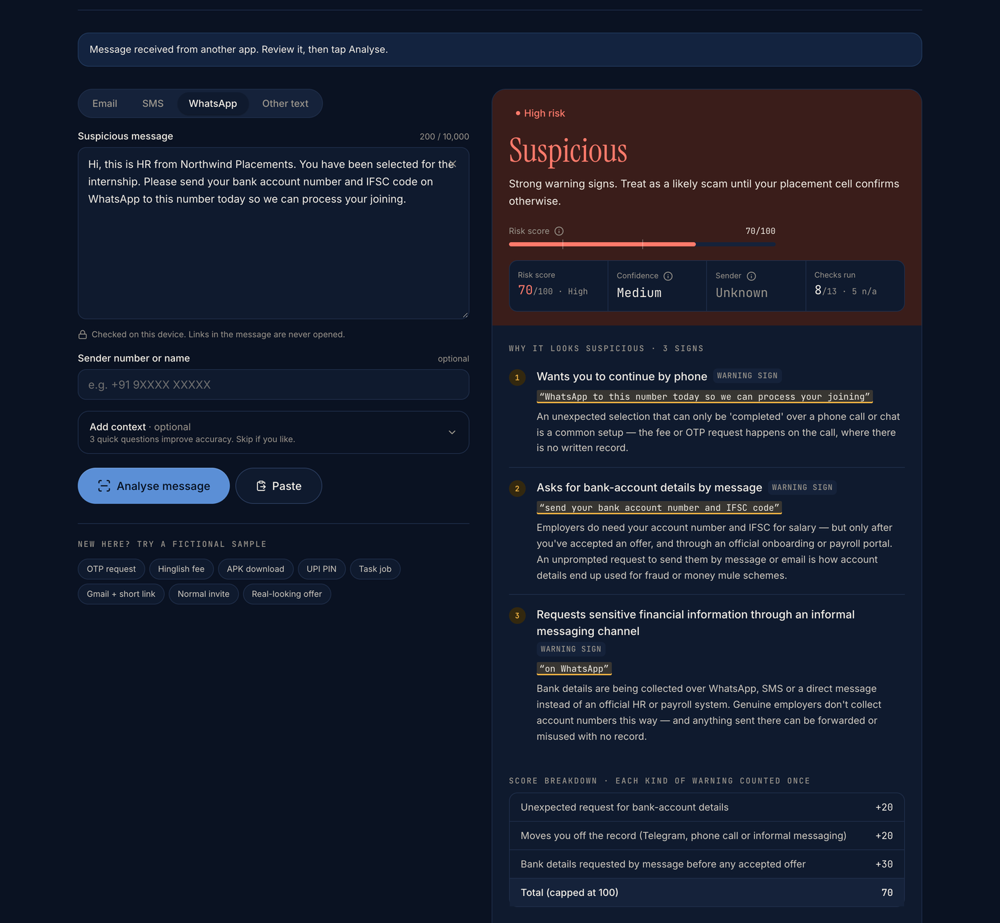
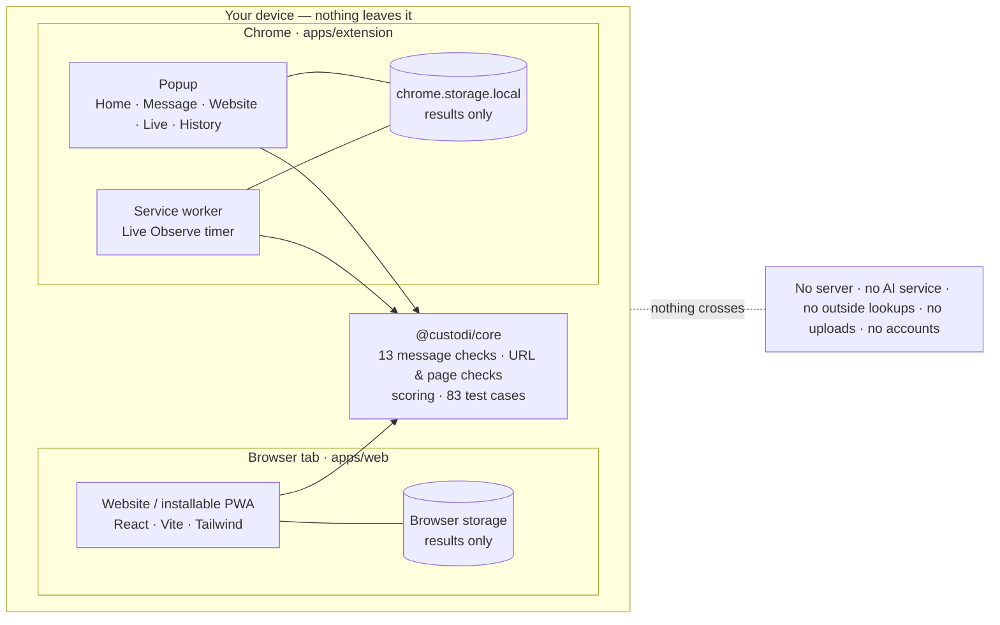
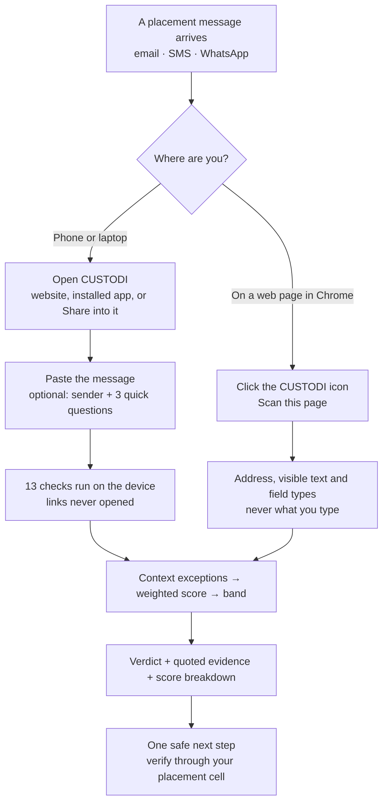
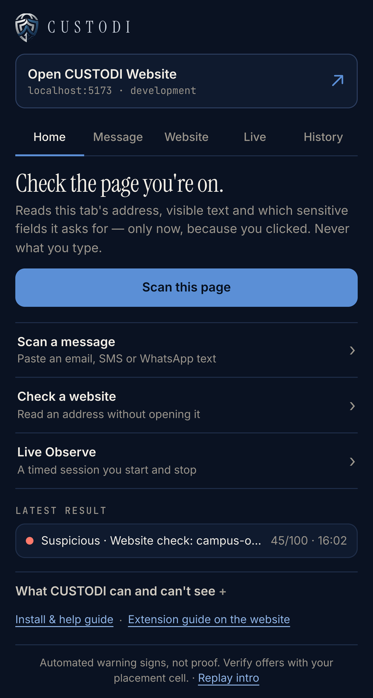
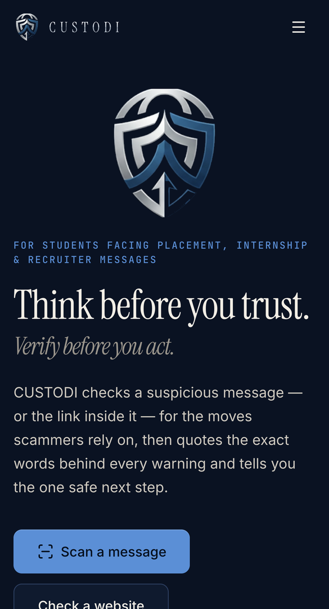
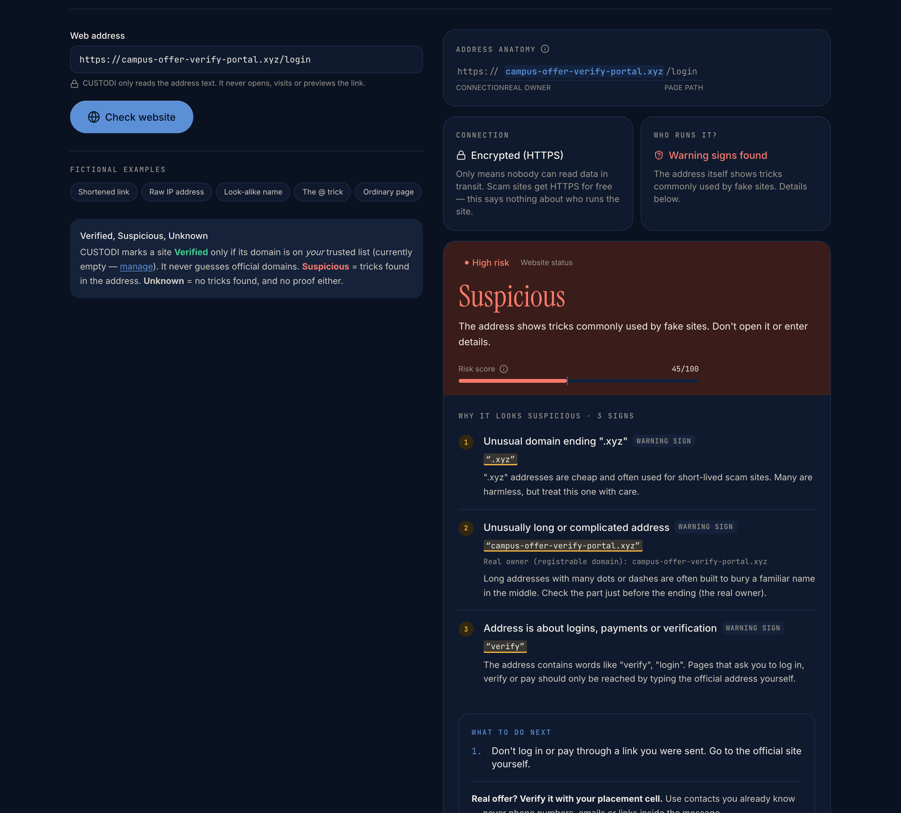
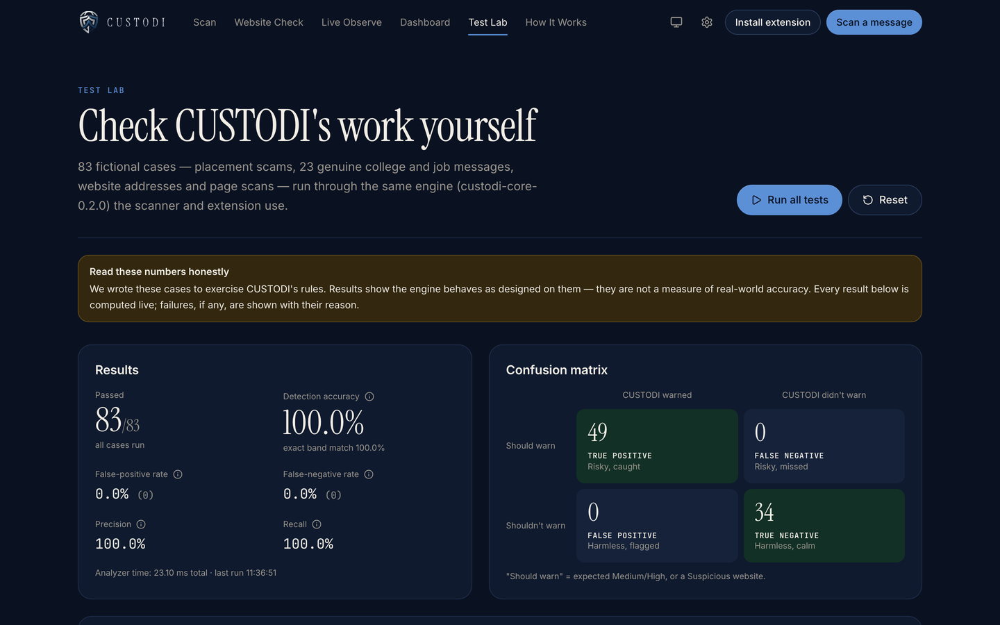

<div align="center">


# CUSTODI

**Think before you trust. Verify before you act.**

An on-device safety check for placement, internship and recruiter messages — and the links inside them.

[Run it](#run-it-locally) · [How scoring works](#how-the-risk-score-works) · [Chrome extension](#chrome-extension) · [Limitations](#honest-limitations) · [Pitch deck](presentation/)

<sub>Hackathon prototype · Arthakram Rapid Prototyping Hackathon · PS 5 “The Fake HR Email”</sub>

</div>

<br />

<p align="center">
  
</p>

## The problem

A fake placement offer doesn't look fake. It looks like good news:

> *“You have been selected for the internship. Please send your bank account number and IFSC code on WhatsApp to this number today…”*

There's a lure (selected, with no process), an ask (bank details before any accepted offer), an unofficial channel and a deadline. Nothing is obviously malicious — which is why “be careful” isn't enough, and why a blanket “never share bank details” rule fails: real employers *do* need them, later, through an official portal.

## What CUSTODI does

CUSTODI reads a message or web address **the way a security analyst would**, on the student's own device, and returns:

- a risk level — **Low risk · Caution · Suspicious** — with a score out of 100,
- the **exact words** that raised concern, highlighted in place,
- every point that made up the score,
- **one safe next step**, usually: verify through your placement cell, never through contacts inside the message.

It never uploads anything, never opens links, and never calls anything “safe”.

| | What you get |
|---|---|
| **Message scan** | Email, SMS, WhatsApp or any text. 13 checks, evidence highlighted, score breakdown, next steps, copyable incident report. |
| **Website check** | Reads an address *without opening it*: real owner, look-alike spellings, hidden destinations, risky endings, connection — and keeps “encrypted” apart from “genuine”. |
| **Chrome extension** | Scan the page you're on with one click, scan a message or an address in the popup, see your latest result, open the website. Optional, timed **Live Observe** sessions. |
| **Installable app (PWA)** | Works offline once loaded. On Android, *Share* a message from another app straight into CUSTODI. |
| **Dashboard** | Your scans on this device: risk trend, warning categories, full reports, JSON / CSV export, delete. |
| **Test Lab** | 83 fictional cases run live in the browser, with expected vs. actual results and a confusion matrix. |

## How the risk score works

Transparent, hand-set rules — no black box, no AI service. Each **kind** of warning adds fixed points **once**, however many phrases trigger it, capped at 100 ([`scoring.ts`](packages/core/src/scoring.ts)).

| Warning | Points | | Warning | Points |
|---|---:|---|---|---:|
| OTP / PIN / password request | +35 | | Account closure or threat | +15 |
| Payment, deposit or fee | +30 | | Secrecy / “don't verify” | +15 |
| App install or remote access | +30 | | Suspicious or disguised link | +15 |
| Impersonation / domain mismatch | +20 | | Artificial urgency | +10 |
| Moves you off the record | +20 | | Unrealistic reward | +10 |
| Bank-detail request · ID documents over chat · job with no assessment · hidden AI instructions · sensitive request you report | +20 each | | Unexpected contact | +5 |

Context modifiers: **+20** for a fee in a job context · **+30** for bank details requested by message before any accepted offer.

**Bands:** `0–19` Low risk · `20–49` Caution · `50–100` Suspicious.
**Critical override:** a direct OTP/PIN/password request, a remote-access tool or an `.apk`/`.exe` install is always Suspicious, whatever the total.

**Context exceptions** turn a warning into a 0-point *note* (still shown) when the words are quoted inside a scam-awareness notice, when an OTP is delivered *to you* with “never share it”, or when bank details go to an official portal and aren't asked back by message. The same request, three answers:

| Message | Score | Why |
|---|---:|---|
| WhatsApp, before any offer: *“send your bank account number and IFSC code on WhatsApp to this number”* | **70 · Suspicious** | +20 bank details · +20 off the record · +30 by message before an accepted offer |
| Email from a Gmail address after accepting: *“email us your bank account number”* (Test Lab R10) | **40 · Caution** | +20 bank details · +20 personal email for official hiring |
| After accepting: *“add your bank account number on the official onboarding portal”* (Test Lab M42) | **0 · Low risk** | Official portal, not asked back by message → note only |

Confidence (how much CUSTODI had to work with) and sender status (*verified* only for domains on **your** trusted list) are reported separately. The weights are calibrated on our fictional cases — **not** a probability of fraud.

## Architecture

One TypeScript analyzer, imported by every front end. Everything stays inside the device boundary.



The extension reads a page only after a click (`activeTab`) or during a Live Observe session you start; it talks to the website only on `localhost` (Live Observe status).

## User workflow



## Run it locally

Requires **Node.js 20.19+** (or 22+) and npm. No API keys, accounts or `.env` file are needed.

```bash
npm install
npm run dev          # website → http://localhost:5173
```

```bash
npm test             # 120 analyzer unit tests (Vitest)
npm run check        # typecheck + tests + build website and extension
npm run build:web    # production website → apps/web/dist
```

### Deploy (Vercel)

`vercel.json` holds the settings: Root Directory = repository root, Framework = *Other*, `npm ci`, **`npm run build:deploy`**, output `apps/web/dist`, Node 22.x.

`build:deploy` ([scripts/build-release.mjs](scripts/build-release.mjs)) builds the website, builds the Chrome extension pointed at the deployed address (Vercel's `VERCEL_PROJECT_PRODUCTION_URL`, or `CUSTODI_WEB_URL` to override), adds that origin to the extension's `externally_connectable`, and publishes **`/downloads/custodi-extension.zip`** (plus version, size and SHA-256 in `custodi-extension.json`) for the website's download page at `/extension`.

## Chrome extension

```bash
npm run build:extension
```

1. Open `chrome://extensions` and switch on **Developer mode**.
2. Click **Load unpacked** and choose `apps/extension/dist` (the folder with `manifest.json`).
3. Pin CUSTODI from the puzzle-piece menu.

The popup opens on **Home**: *Open CUSTODI Website*, *Scan this page*, quick routes to **Message**, **Website** and **Live Observe**, your latest result, and what the extension can and can't see.

**Website link.** The extension opens and talks to `https://custodi-phi.vercel.app`. That address is set once in `DEFAULT_PRODUCTION_URL` in [`apps/extension/vite.config.ts`](apps/extension/vite.config.ts); a build can override it with `VITE_CUSTODI_WEB_URL=https://…`. Localhost is still accepted for development.

| Permission | When | Why |
|---|---|---|
| `activeTab` | at install | Read the current tab, only at the moment you click |
| `scripting` | at install | Read visible text and form-field *types* when you scan — never what you type |
| `storage` | at install | Keep results on your computer |
| `alarms` | at install | End a Live Observe session on time |
| all sites (optional) | only when you start Live Observe | Check pages during the session; handed back when it ends |

## Validation

| | Result | Scope |
|---|---|---|
| Analyzer unit tests | **120 / 120 pass** | `npm test` (Vitest) |
| Test Lab | **83 / 83 behave as designed** | 49 risky cases warned · 34 harmless cases calm · 0 false positives · 0 false negatives |

The Test Lab (`/lab`) runs every case live in your browser. These are **our own fictional cases**, including 23 genuine college and job messages that must stay calm — they show the engine behaves as designed, **not** real-world accuracy. A false alarm found during real-Chrome testing is kept as regression case R01.

## Privacy and security

- Messages and addresses are analysed in memory, on the device. **No server, no AI API, no analytics, no uploads.**
- Links are read as text — never opened, fetched or previewed.
- Only results (with short evidence quotes) are stored by default; full text is opt-in. Export or delete any time.
- Submitted text is treated as untrusted data; hidden instructions aimed at AI checkers are flagged, not followed.
- CUSTODI never asks for OTPs, PINs, passwords or bank details.

## Honest limitations

- Can't read WhatsApp, SMS or email inboxes — you paste or share the message in.
- No blocklist, domain-age or sender-authentication lookups. Those checks are shown as **unavailable**, never faked.
- Rules-based: new scam wording can slip through. **Low risk means no obvious signs — never “safe”.**
- English and common Hinglish phrasing only.
- Weights are tuned on our own fictional cases; there is no real-world accuracy figure yet.
- The extension is loaded unpacked; it isn't on the Chrome Web Store.

## Roadmap — proposed, not built

1. Pilot with a placement cell, measuring on real, consented and anonymised messages.
2. Recruiter domains verified by the placement cell, feeding the trusted list.
3. Chrome Web Store release.
4. Opt-in reputation lookups (domain age, blocklists) — only with consent.
5. More Indian languages.

## Screenshots

Real captures of the current build; every message and address shown is fictional.

| Chrome extension popup | Home (phone) |
|---|---|
|  |  |

| Website check | Test Lab |
|---|---|
|  |  |

More: [home page](docs/screenshots/custodi/home.png) · [dashboard](docs/screenshots/custodi/dashboard.png) · [extension guide](docs/screenshots/custodi/extension-guide.png)

## Project structure

```
apps/web          Website + installable PWA (React 19, Vite 7, Tailwind CSS v4, Framer Motion, GSAP)
apps/extension    Chrome extension, Manifest V3 (popup, service worker, welcome guide)
packages/core     Shared analyzer: message pipeline, URL & page checks, scoring, Test Lab cases, unit tests
presentation/     Pitch deck (PPTX + PDF), presenter script, judge Q&A
scripts/          Logo/icon generator (Node) and intro-video renderer (Swift + ffmpeg, macOS)
docs/             Screenshots and notes
frontend/ backend/ research/   Earlier “TrustLayer AI” prototype and planning material (not used by CUSTODI)
```

**Stack:** TypeScript · React 19 · Vite 7 · Tailwind CSS v4 · Framer Motion · GSAP · react-router 7 · vite-plugin-pwa · Vitest · Chrome Manifest V3. More detail in [CUSTODI.md](CUSTODI.md).

## Team

Antriksh · Darsh · Kushagri

<sub>CUSTODI gives automated warning signs for safety education, not proof. Verify important opportunities through your placement cell.</sub>
