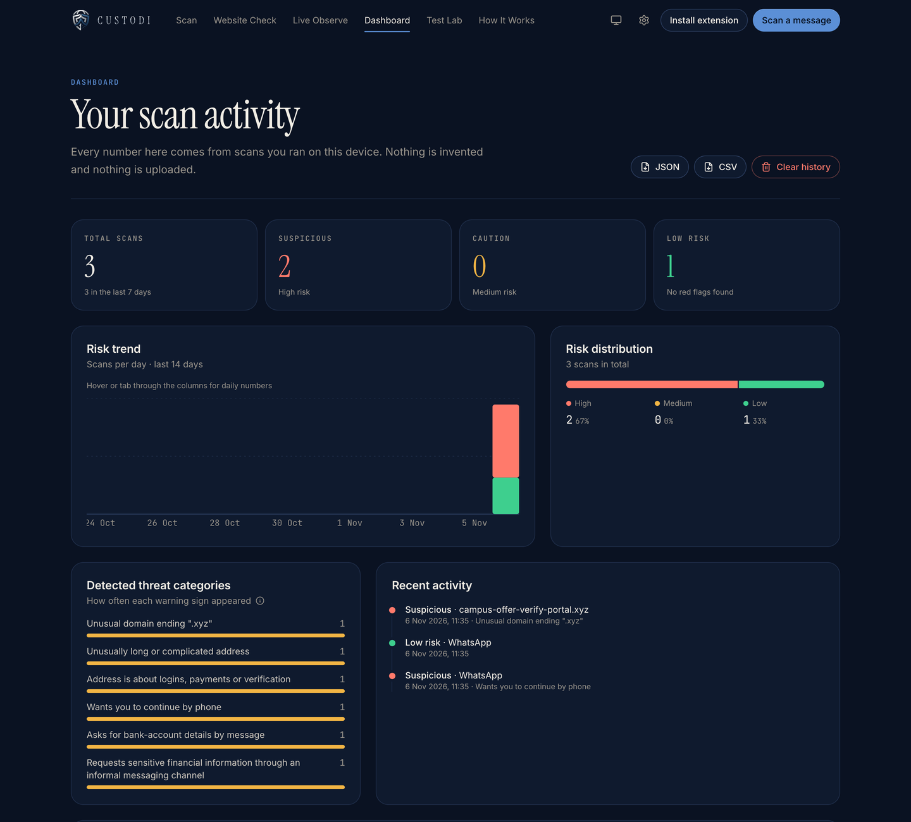

# CUSTODI — Your Personal Digital Bodyguard

**Think before you trust. Verify before you act.**

CUSTODI is a privacy-first cybersecurity platform that detects suspicious HR emails, fake job offers, phishing messages, and unsafe websites through transparent risk analysis, website checks, and a Chrome extension. Think before you trust. Verify before you act.

CUSTODI helps students check suspicious placement, internship and recruiter messages — and the links in them —
before they act. Paste an email, SMS or WhatsApp message (or check a web address, or the page you're on in Chrome)
and get a risk level, the exact words that raised concern, a transparent score breakdown and a safe next step.

Built for the Arthakram Rapid Prototyping Hackathon (PS 5 — "The Fake HR Email"). **Hackathon prototype.**

Everything runs on the user's device: no server, no AI service, no uploads.

## Screenshots

Real captures of the current build (every message and address shown is fictional).

| Message scan — evidence and score breakdown | Website check — address read, never opened |
|---|---|
|  |  |

| Test Lab — 83 fictional cases run live | Dashboard — on-device scan history |
|---|---|
|  |  |

More: [home page](docs/screenshots/custodi/home.png) · [phone](docs/screenshots/custodi/mobile-home.png) ·
[Chrome extension guide](docs/screenshots/custodi/extension-guide.png) ·
pitch deck, script and judge Q&A in [`presentation/`](presentation/).

## What's in this repository

```
presentation/     Pitch deck (PPTX + PDF), presenter script and judge Q&A
packages/core     Shared detection engine — 13-check message pipeline, website & page analysis,
                  weighted scoring, 83 fictional Test Lab cases, 120 unit tests (Vitest)
apps/web          Website + installable PWA (React, Vite, Tailwind CSS v4, Framer Motion, GSAP)
apps/extension    Chrome extension (Manifest V3): scan this page, message scan, Live Observe sessions
scripts/          Logo/icon generator (Node) and intro-video renderer (Swift + ffmpeg, macOS)
frontend/, backend/, research/, docs/   Earlier "TrustLayer AI" prototype and planning material (legacy, not used by CUSTODI)
```

The website, the PWA and the extension all import the same analyzer from `packages/core`.

## Run it

Requires Node.js 20.19+ (or 22+) and npm. No API keys, accounts or `.env` file are needed.

```bash
npm install
npm run dev            # website at http://localhost:5173
npm test               # analyzer unit tests
npm run check          # typecheck + tests + build website and extension
```

### Chrome extension
```bash
npm run build:extension
```
Then open `chrome://extensions`, turn on **Developer mode**, click **Load unpacked** and choose `apps/extension/dist`.
Full guide: the website's `/extension` page, or [CUSTODI.md](CUSTODI.md).

### Deploy the website (Vercel)
`vercel.json` at the repository root holds the settings. In the Vercel project, leave **Root Directory** empty
(repository root) and **Framework Preset** as *Other*; the file supplies `npm ci`, `npm run build:web` and the
output directory `apps/web/dist`. The Chrome extension is not deployed — it is loaded from `apps/extension/dist`.

## How detection works

Transparent, deterministic rules — no black box. Each kind of warning adds fixed points, counted once:
OTP/PIN/password request +35, payment or fee +30, app install or remote access +30, impersonation +20, threats +15,
secrecy +15, disguised link +15, urgency +10, unrealistic reward +10, unexpected contact +5 (plus documented
context modifiers). **0–19 Low · 20–49 Medium · 50–100 High.** Direct OTP/PIN/password requests and remote-access
installs are always High. Risk, confidence and sender verification are reported separately. Details: [CUSTODI.md](CUSTODI.md).

The Test Lab (`/lab`) runs every fictional case live and shows true/false positives and negatives. These are the
team's own cases — **not** a real-world accuracy figure.

## Privacy and limits

- Messages and links are analysed on the device; links are never opened.
- Only results (not full messages, by default) are stored in the browser, with export and delete controls.
- The extension only reads a page when you click, or during a timed Live Observe session you start and can stop.
  It cannot read WhatsApp, SMS or email inboxes.
- CUSTODI gives automated warning signs, not proof. A Low result does not guarantee a message is safe.
  Verify important offers through your placement cell. Never share passwords, OTPs or payment credentials.

## Team
Antriksh (frontend + product) · Darsh (backend) · Kushagri (R&D + QA) · Teammate 4 (AI integration + DevOps)
